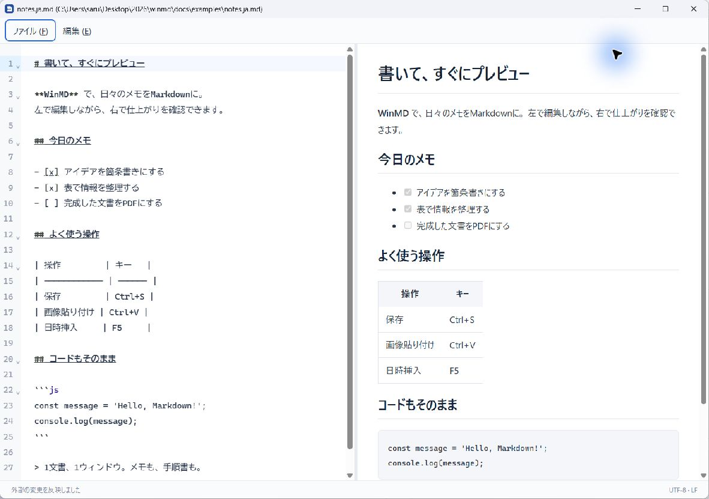

# WinMD

**WindowsでMarkdownを書く。仕上がりを、その場で確認。**

[English](README.md) | 日本語

WinMDは、左でソースを編集し、右でプレビューを確認できるMarkdownエディタです。文書ごとに独立したウィンドウが開くので、メモや手順書を並べて作業できます。アプリのUIは日本語です。

[ダウンロード](https://github.com/sarulab-ou/winmd/releases) · [使い方](#使い方) · [MITライセンス](LICENSE)



_WinMD v0.1.8の実画面。[サンプル文書](docs/examples/notes.ja.md)を表示しています。_

## できること

- **書きながらプレビュー。** 見出し、箇条書き、表、コードブロックの仕上がりを確認できます。中央の境界をドラッグして幅も調整できます。
- **Ctrl+Vで画像を貼り付け。** 文書と同じフォルダーに`YYYYMMDD_HHMMSS.png`形式で保存し、画像リンクを挿入します。
- **ほかのエディタと一緒に使える。** Codexなどが外部で更新すると、未保存の編集がない場合は自動反映します。WinMDでも編集中なら、編集を保持して競合を通知します。
- **PDFにエクスポート・印刷。** 未保存の編集も含め、プレビューの本文を出力できます。
- **1文書、1ウィンドウ。** 文書を好きな位置に並べて使えます。タブはありません。
- **慣れたショートカットで操作。** 検索・置換・保存に加え、F5で現在の日時を挿入できます。

## ダウンロード・インストール

**[Windows x64インストーラー — GitHub Releases](https://github.com/sarulab-ou/winmd/releases)**

初回のバイナリリリースを準備中です。GitHub Releasesにインストーラーはまだ公開していません。公開前に試す場合は、[ソースからのビルド手順](docs/development.md)を参照してください。

1. リリース公開後、`WinMD_<version>_x64-setup.exe`をダウンロードし、**Windows 11 x64**で実行します。
2. WebView2 Runtimeがない場合は、インストーラーがダウンロードします。この場合はインターネット接続が必要です。
3. `.md`をダブルクリックで開きたい場合は、Windowsの既定アプリ設定でWinMDを選択します。インストーラーから設定画面を開けます。

現在のv0.1.8は、GNUツールでクロスビルドした署名なしの試用版です。インストール・実GUI全体の受入確認は未完了です。[検証記録](docs/verification.md)を参照してください。

## 使い方

1. **Ctrl+N**で新しいウィンドウ、**Ctrl+O**で既存のMarkdownファイルを開きます。[サンプル文書](docs/examples/notes.ja.md)でも試せます。
2. 左側で編集し、右側で仕上がりを確認します。
3. **Ctrl+S**で保存します。新規文書は保存先のフォルダーとファイル名を選びます。
4. 画像をコピーして、エディタで**Ctrl+V**。文書の隣に`20261026_231824.png`のようなPNGを保存し、Markdownの画像リンクを挿入します。新規文書は先に保存します。
5. **Alt+F**で「ファイル (F)」を開き、**PDFにエクスポート**または**印刷（Ctrl+P）**を選びます。


_PDF出力・印刷はファイルメニューから。出力するのは本文だけで、エディタやメニューは含みません。_

PDFはA4縦です。PDF出力・印刷によってMarkdownの原本を保存することはありません。外部画像はプレビュー・出力ともにブロックします。

## 主なショートカット

| 操作                           | キー                                |
| ------------------------------ | ----------------------------------- |
| ファイル / 編集メニュー        | Alt+F / Alt+E                       |
| 新しい文書を別ウィンドウで開く | Ctrl+N                              |
| 開く                           | Ctrl+O                              |
| 保存 / 名前を付けて保存        | Ctrl+S / Ctrl+Shift+S               |
| 元に戻す / やり直す            | Ctrl+Z / Ctrl+Y または Ctrl+Shift+Z |
| 切り取り / コピー / 貼り付け   | Ctrl+X / Ctrl+C / Ctrl+V            |
| 選択範囲の削除                 | Del                                 |
| 検索 / 置換                    | Ctrl+F / Ctrl+H                     |
| 次を検索 / 前を検索            | F3 / Shift+F3                       |
| タイムスタンプを挿入           | F5                                  |
| 印刷                           | Ctrl+P                              |
| 現在のウィンドウを閉じる       | Ctrl+W / Alt+F4                     |

F5はPCのローカル時刻を使い、`2026/01/27 08:38:02`のように`yyyy/mm/dd hh:mm:ss`（24時間制）で挿入します。画像の保存名は`YYYYMMDD_HHMMSS.png`です。

## ファイルの扱いと制限

- 文書は通常のMarkdownファイル、画像はローカルファイルとして保存します。タイトルは`ファイル名 (フルパス)`で、未保存の変更は`*`で示します。
- **保存はCtrl+Sで。** 自動保存・クラッシュ復元はありません。既存文書や同名の貼り付け画像を無断で上書きしません。
- UTF-8のBOM有無、LF/CRLF、末尾改行の有無を保持します。改行混在は読み取り専用、不正UTF-8は読み込みを拒否します。
- 生HTMLはエスケープし、プレビューをサニタイズします。外部画像はブロックします。
- 文書は32 MiB以下。ローカル画像は文書フォルダー配下のPNG/JPEG/GIF/WebPで、1枚16 MiB以下・先頭100件までです。
- 画像貼り付けは16 MiB・16メガピクセルまで。同じ秒の同名画像がある場合は、1秒待って再度貼り付けてください。画像リンクをUndoしてもPNGファイルは残ります。

## Codexから開く

Windowsで`.md`をWinMDに関連付けると、Codexの「アプリで開く」→ **Default app**からMarkdownをWinMDで開けます。

メニューに**WinMD**という項目を追加したい場合は、ユーザー設定の`~/.codex/config.toml`にカスタムハンドラーを登録し、Codexを再起動します。これは任意の設定で、全ファイルの優先エディタを変更する必要はありません。[公式の登録手順](https://learn.chatgpt.com/docs/config-file/config-advanced#add-custom-file-handlers)を参照してください。

## 開発

Tauri 2、TypeScript、Vite、CodeMirror 6、marked、DOMPurify、Rustで実装しています。

```powershell
$env:CI='true'
pnpm install --frozen-lockfile
pnpm desktop:dev
```

前提環境と検証コマンドは[開発・ビルドガイド](docs/development.md)を参照してください。フロントエンドの検証は`pnpm run check`、`pnpm run test`、`pnpm run lint`、`pnpm run build`、Windowsインストーラーのビルドは`pnpm desktop:build`です。

[設計判断](docs/design.md) · [手動テスト](docs/manual-tests.md) · [検証記録](docs/verification.md)

## ライセンス

[MITライセンス](LICENSE)。依存ライブラリのライセンスはそれぞれ維持します。[第三者ライセンス通知](docs/third-party-licenses.txt)を参照してください。
