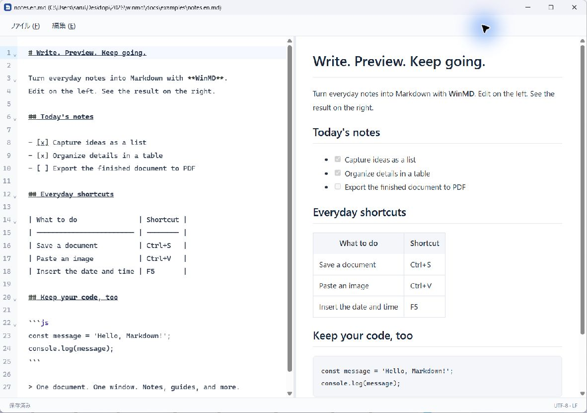
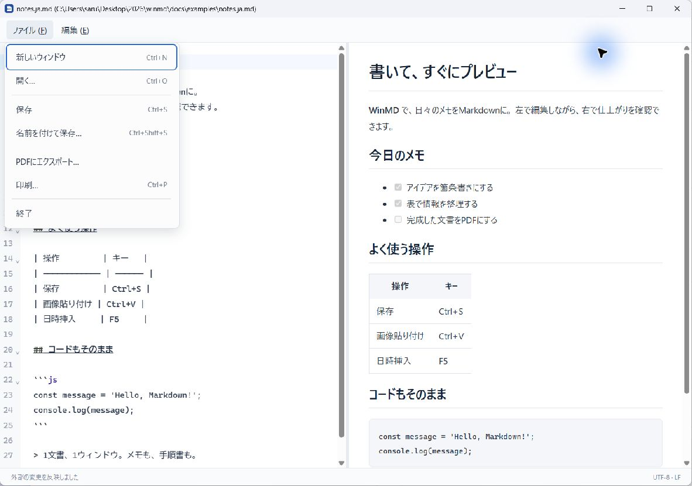

# WinMD

**Write Markdown on Windows. See the result as you type.**

English | [日本語](README.ja.md)

WinMD is a Markdown editor with source on the left and a live preview on the right. Each document opens in its own window, so you can arrange notes and guides side by side. The application UI is currently Japanese.

[Downloads](https://github.com/sarulab-ou/winmd/releases) · [Quick start](#quick-start) · [MIT License](LICENSE)



_An actual WinMD v0.1.8 window displaying the [English sample](docs/examples/notes.en.md)._

## What you can do

- **Write and preview together.** Check headings, lists, tables, and code blocks while editing. Drag the divider to adjust the panes.
- **Paste images with Ctrl+V.** Images are saved beside your Markdown file as `YYYYMMDD_HHMMSS.png`, and an image link is inserted for you.
- **Work alongside other editors.** Changes made by Codex or another tool reload automatically when there are no unsaved edits. If you are editing in WinMD too, your edits are kept and a conflict notice appears.
- **Export to PDF or print.** Output the rendered document, including your latest unsaved edits.
- **Keep documents in separate windows.** Arrange each document where you need it. There are no tabs.
- **Use familiar shortcuts.** Find, replace, save, and insert the current date and time with F5.

## Download and install

**[Download WinMD v0.1.8 for Windows x64](https://github.com/sarulab-ou/winmd/releases/download/v0.1.8/WinMD_0.1.8_x64-setup.exe)**

WinMD v0.1.8 is available as a preview release. [Release notes](https://github.com/sarulab-ou/winmd/releases/tag/v0.1.8) · [SHA-256 checksums](https://github.com/sarulab-ou/winmd/releases/download/v0.1.8/SHA256SUMS.txt) · [Build from source](docs/development.md)

1. Download `WinMD_0.1.8_x64-setup.exe` and run it on **Windows 11 x64**.
2. If WebView2 Runtime is missing, the installer downloads it; this step requires internet access.
3. To open `.md` files by double-clicking, choose WinMD in Windows' default app settings. The installer can open those settings for you.

The current v0.1.8 build is unsigned and was cross-compiled with GNU tools. Installation and full GUI acceptance testing are still incomplete; see the [verification record](docs/verification.md).

## Quick start

1. Press **Ctrl+N** for a new window or **Ctrl+O** to open an existing Markdown file. You can also try the [sample note](docs/examples/notes.en.md).
2. Write on the left and check the preview on the right.
3. Press **Ctrl+S** to save. For a new document, choose a folder and filename.
4. Copy an image and press **Ctrl+V** in the editor. WinMD saves a PNG such as `20261026_231824.png` next to the document and inserts its Markdown link. A new document must be saved first.
5. Open **ファイル (F)** with **Alt+F**, then choose **PDFにエクスポート** (Export to PDF) or **印刷** (Print, **Ctrl+P**).



_PDF export and printing are available from the File menu. Only the rendered document is output; the editor and menus are excluded._

PDF export uses A4 portrait. Exporting or printing does not save the Markdown source. Remote images are blocked in both preview and output.

## Shortcuts

The Japanese menus are **ファイル (F)** (File) and **編集 (E)** (Edit).

| Action                            | Shortcut                        |
| --------------------------------- | ------------------------------- |
| File / Edit menu                  | Alt+F / Alt+E                   |
| New document in a separate window | Ctrl+N                          |
| Open                              | Ctrl+O                          |
| Save / Save As                    | Ctrl+S / Ctrl+Shift+S           |
| Undo / Redo                       | Ctrl+Z / Ctrl+Y or Ctrl+Shift+Z |
| Cut / Copy / Paste                | Ctrl+X / Ctrl+C / Ctrl+V        |
| Delete selection                  | Del                             |
| Find / Replace                    | Ctrl+F / Ctrl+H                 |
| Find next / previous              | F3 / Shift+F3                   |
| Insert timestamp                  | F5                              |
| Print                             | Ctrl+P                          |
| Close the current window          | Ctrl+W / Alt+F4                 |

F5 inserts the PC's local date and time as `2026/01/27 08:38:02` (`yyyy/mm/dd hh:mm:ss`, 24-hour clock). Pasted image filenames use `YYYYMMDD_HHMMSS.png`.

## Files and limits

- Files stay as ordinary Markdown and local images. The title bar shows `filename (full path)`; `*` marks unsaved edits.
- **Save with Ctrl+S.** There is no autosave or crash recovery. Existing documents and same-named pasted images are not silently overwritten.
- UTF-8 BOM settings, LF/CRLF line endings, and trailing newlines are preserved. Mixed line endings open read-only; invalid UTF-8 is rejected.
- Raw HTML is escaped, preview output is sanitized, and remote images are blocked.
- Documents are limited to 32 MiB. Local images must be inside the document's folder: PNG/JPEG/GIF/WebP, up to 16 MiB each, first 100 images.
- Image paste is limited to 16 MiB and 16 megapixels. If a timestamp filename already exists, wait one second and paste again. Undoing the inserted link leaves the PNG file in place.

## Use with Codex

Associate `.md` with WinMD in Windows, then choose **Default app** in Codex's **Open in** menu to open Markdown files in WinMD.

To add a separate **WinMD** entry to that menu, register a custom handler in your user-level `~/.codex/config.toml`, then restart Codex. This is optional and does not require changing your preferred editor for all files. See the [official custom handler instructions](https://learn.chatgpt.com/docs/config-file/config-advanced#add-custom-file-handlers).

## Development

Built with Tauri 2, TypeScript, Vite, CodeMirror 6, marked, DOMPurify, and Rust.

```powershell
$env:CI='true'
pnpm install --frozen-lockfile
pnpm desktop:dev
```

See the [development and build guide](docs/development.md) for prerequisites and validation commands. Use `pnpm run check`, `pnpm run test`, `pnpm run lint`, and `pnpm run build` for frontend validation. Build the Windows installer with `pnpm desktop:build`.

[Design decisions](docs/design.md) · [Manual tests](docs/manual-tests.md) · [Verification record](docs/verification.md)

## License

[MIT License](LICENSE). Dependencies retain their own licenses; see [third-party notices](docs/third-party-licenses.txt).
